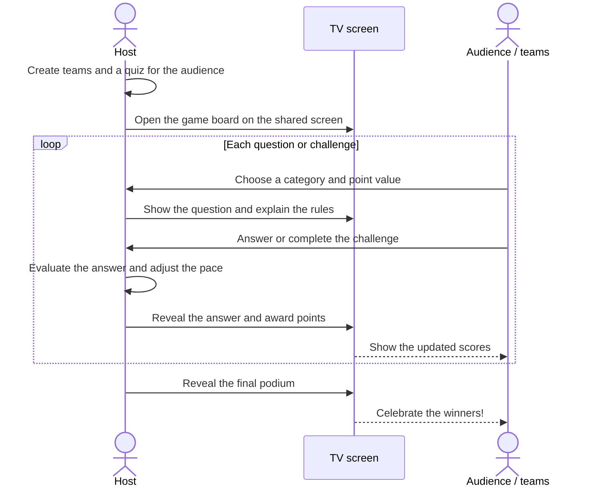
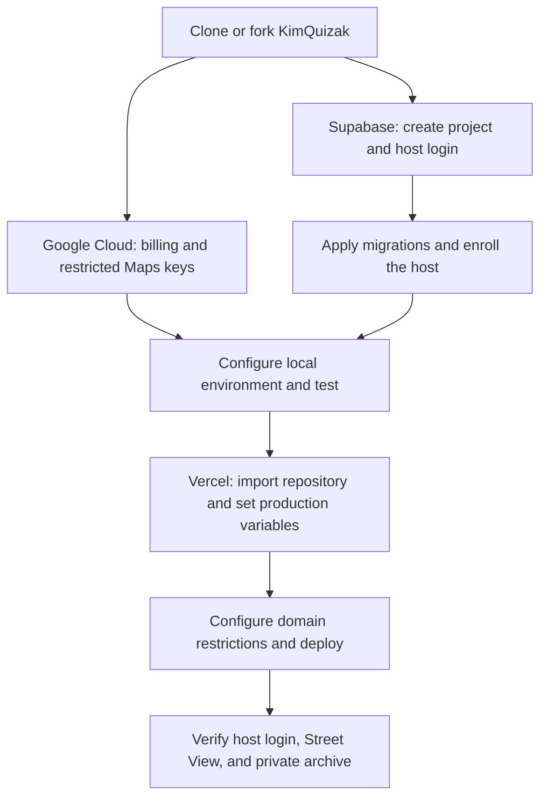
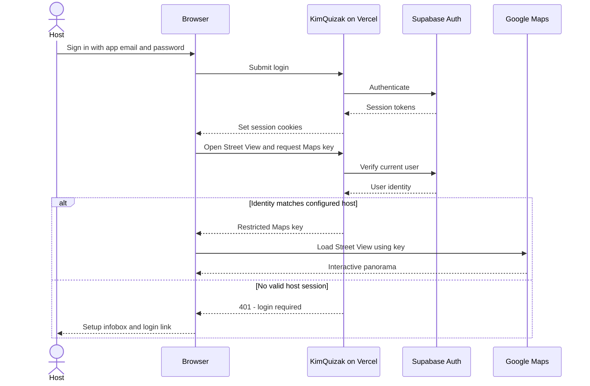
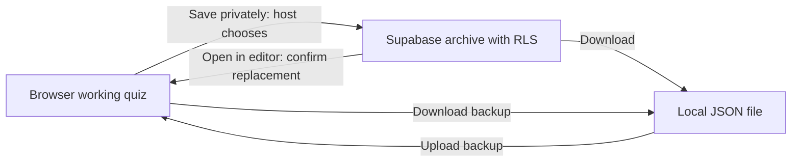

# kimquizak

Lightweight quiz game board built with Next.js 16 (App Router + TypeScript). Configure teams and categories, then run the game with a slot-machine turn order picker, question modals, timelines, audio clips, text grids, and more. State is stored locally in the browser.

## How to play

The host runs KimQuizak on a shared TV or projector. Teams answer in the room; the host controls the pace, judges answers, and awards points.



## Quick start
Use Node.js 22 (also configure Vercel to use Node.js 22). The Supabase SDK requires Node.js 22 or newer; this project targets 22.x.

```bash
npm install
npm run dev
```

Development uses Webpack, matching the production build, to avoid a Turbopack hot-reload panic. After changing the dev command, stop the existing server with Ctrl+C and run `npm run dev` again.

Open http://localhost:3000 and use the config pages to add teams and questions. The game starts empty (no default categories/questions), so add your own before playing.
Prod: https://kimquizak.com/

## Main flows
- With **Brand the site** off, Kim Quizak uses its own year-round quiz-club style: deep green, brass details, and question-mark medallions. Seasonal decorations appear only with the matching site branding enabled.
- `Home / Team palette`: choose **Capra × Liflig** for eight locally bundled Noto animal icons. For every team palette, the optional **Brand the site** switch applies matching colors across the app while preserving team identities and game-state colors. The preference is included in backups and follows the selected palette. Artwork attribution is in `public/team-animals/NOTICE.txt`.
- `Config / Teams`: set team names, colors/emojis and players; shuffle players; reset the turn order.
- `Config / Questions`: add and reorder categories, add or remove questions within each category in 100-point steps, configure whether category titles start concealed, and build question types (standard, text grid, geoguesser, joker, timeline, MCQ, audio). Question editors start collapsed to protect answers during live hosting, and can be opened independently or as a category. Drag questions within a category to reorder point slots. Categories can have different lengths; missing board positions remain empty.
- `Game`: draw the complete board-turn order with sleigh bells, reveal concealed category titles, play tiles, and track scores/answers. A glockenspiel confirms the selected opening team. Board turn advances after each resolved question.

## Question types (cheat sheet)

- **Connections**: four hidden groups of four tiles. The host chooses how many connections (1–4) must be found to finish; points are split across that target. Shuffle unsolved tiles during play; near misses briefly show “Three are correct”. Points per solved group, configurable rollover, a per-guess timer (default 120 seconds), and shared mistakes (default 4). The host can end early; remaining solutions reveal one by one on the answer screen. [Setup, pacing, and rules](docs/connections.md).
- **Standard**: prompt + answer; optional question/answer images.
- **MCQ**: 2–12 options, starting with four. Mark one or more correct answers and choose how many must be found to finish. Points are split across the required correct picks; teams keep their earned points and continue after a correct pick. With rollover enabled, a wrong pick is disabled and passes play to the next team; otherwise it ends the question. Found answers and split scores survive closing/reloading the round, and Reset game progress clears them. Existing single-answer backups still work.
- **Text grid (lyrics)**: one word/segment per line. Answer video must be a YouTube *embed* URL (not a share link). Red tiles rotate to the next team and shave the pot; “Next team” button available for hosts on wrong guesses.
- **Geoguesser**: find a place in Google Maps, paste its link, adjust the nearby Street View scene, and save the opening frame. Google Maps share links, Street View URLs, and iframe code are supported. The question starts on a fixed view. A timed choice to look around and move drops the correct-answer payout by one or two board-value levels; the host can freely explore on the answer side. Google's road/address overlays are hidden without cropping.
- **Timeline**: events with years. Center year/label configurable. Rotation on miss optional.
- **Audio**: paste any regular YouTube URL, configure start time and clip length, and preview the source. Optionally allow one replay that lowers a correct answer to the next lower board-value tier.
- **Challenge**: write a task with an optional picture and optional host-started countdown or count-up clock. The clock can show exact time or only an animated progress bar. The tile keeps its normal point value; after the reveal, the host marks the challenge completed for full points or not completed for 0 points. Reaching the time limit never scores automatically. Existing saved booby-trap tiles use this new behavior.
- **Joker high/low**: configurable count, min/max, rotation on miss, and a six-level prize ladder worth 20%, 25%, 33%, 44%, 72%, or 100% of the question's total points. Players start at level 1, move exactly one level up or down after each guess, and jump directly to level 6 when the hidden Joker is found.

## Self-hosting guide

Run your own copy with **your own Google Cloud project, Supabase project, and Vercel deployment**. This repository contains no working credentials. The bundled players and relationships are fictional; personal quizzes belong in browser storage, private backups, or your Supabase archive.

Local editing, file backups, and the other question types work without cloud setup. **Interactive Geoguesser requires a configured Google Maps key and a signed-in host. There is no offline or image fallback.** Players watching the host's shared screen do not need accounts. Cloud saves are a convenience; Supabase Auth provides login independently of the archive.



### 1. Clone and run locally

Use Node.js 22. Fork the repository into your own GitHub account if you want Vercel to deploy your changes, then clone that fork. For a local evaluation:

```bash
git clone https://github.com/kimisak/kimquizak.git
cd kimquizak
npm install
cp .env.example .env
npm run dev
```

Open `http://localhost:3000`. Only copy the environment template when you do not already have an `.env`; keep your existing values otherwise. **Questions & board → Local archive → Add example data** loads the fictional demo and replaces the current browser quiz.

### 2. Create Google Cloud credentials

1. Create a Google Cloud project for your copy and attach a billing account.
2. Enable **Maps JavaScript API**. The current implementation does not need Maps Embed API, Street View Static API, or Geocoding API.
3. Create separate development and production API keys. They can share one Google Cloud project.
4. For both keys, choose **Websites** under application restrictions and restrict API access to **Maps JavaScript API**.
5. Allow `http://localhost:3000/*` on the development key (add another exact local origin only if you use it).
6. On the production key, allow your own domain, such as `https://quiz.example.com/*`, and your exact Vercel production hostname if you use it. Add `www` separately if needed. Do not allow every `*.vercel.app` deployment.
7. Review Maps usage quotas and configure billing alerts. Budget alerts notify you; they are not a spending cap. Set supported API quotas to limits suitable for your usage and monitor actual consumption.

The key identifies the Google project billed for Maps usage. It is sent to the signed-in browser to load interactive Street View. Storing it in Vercel keeps it out of Git, but does not make it invisible in browser developer tools. Host login and Google's website/API restrictions serve different purposes; use both. Signing in alone does not load Street View.

See [Google's API setup](https://developers.google.com/maps/documentation/javascript/get-api-key), [security guidance](https://developers.google.com/maps/api-security-best-practices), and [usage and billing](https://developers.google.com/maps/documentation/javascript/usage-and-billing), and [budget alerts](https://cloud.google.com/billing/docs/how-to/budgets).

### 3. Create Supabase and your host account

1. Create a Supabase project. Your Supabase dashboard login is separate from the app user you create next.
2. In **Authentication → Users → Add user → Create new user**, create your host email/password account. Confirm the email (or use Auto Confirm User for this account).
3. Disable **Allow new users to sign up** under Authentication settings. Keep anonymous sign-ins disabled. There is no public registration page in this app.
4. Copy the host user's UUID. This single account is allowed to access Street View and the private archive.
5. From the project's **Connect** dialog, copy the project URL and publishable key. The publishable key is intended for browser use; do not substitute a secret/service-role key.
6. In Authentication URL Configuration, set Site URL to your own production URL. The current email/password login does not use an OAuth callback; email recovery or social login would need their own redirect setup if added later.

See [Supabase Auth configuration](https://supabase.com/docs/guides/auth/general-configuration) and [API keys](https://supabase.com/docs/guides/getting-started/api-keys).

### 4. Apply migrations and enroll your host

From the repository root, authenticate the CLI and link **your** project's reference (the identifier in its Supabase dashboard URL):

```bash
npx supabase login
npx supabase link --project-ref YOUR_PROJECT_REF
npx supabase migration list --linked
npx supabase db push --linked --dry-run
npx supabase db push --linked
```

This creates the private archive and its row-level security rules, including deletion. Next, enroll your app host. Replace `YOUR_HOST_UUID` with the UUID from Authentication → Users:

```bash
npx supabase db query --linked "insert into private.quiz_owners (user_id) values ('YOUR_HOST_UUID') on conflict do nothing;"
```

Use that same UUID in `KIMQUIZAK_OWNER_USER_ID`. **The UI says Host; existing environment variables, function names, and database identifiers retain `owner` for compatibility.** No schema rename is required.

The CLI login is an administrative connection used for migrations. It is separate from your app email/password session. Keep CLI credentials local; they are not needed in the Vercel runtime. For future schema changes, add migration files and run `db push`. If you already executed SQL manually, inspect the schema and reconcile migration history before pushing; do not blindly replay the initial setup, which resets table grants. Never use a remote database reset to apply routine updates. See [Supabase migrations](https://supabase.com/docs/guides/deployment/database-migrations).

### 5. Configure environment variables

Put local values in the ignored `.env` file. Add production values in **Vercel → Project → Settings → Environment Variables → Production**.

| Variable | Local development | Vercel production |
| --- | --- | --- |
| `NEXT_PUBLIC_SUPABASE_URL` | Your Supabase project URL | Your Supabase project URL |
| `NEXT_PUBLIC_SUPABASE_PUBLISHABLE_KEY` | Your publishable key | Your publishable key |
| `KIMQUIZAK_OWNER_USER_ID` | Your host's UUID | Same host UUID enrolled in the database |
| `GOOGLE_MAPS_API_DEV_KEY` | Restricted localhost key | Leave unset |
| `GOOGLE_MAPS_API_PROD_KEY` | Usually leave unset | Restricted production key |
| `GOOGLE_MAPS_API_KEY` | Optional override; usually unset | Optional override; usually unset |

A non-empty `GOOGLE_MAPS_API_KEY` takes precedence over both environment-specific keys. Otherwise development uses `DEV_KEY`, and production uses `PROD_KEY` without falling back to the development key. A local production build also uses `PROD_KEY`.

Restart local development after changing `.env`. Redeploy after changing Vercel variables; `NEXT_PUBLIC_` values are embedded at build time. Keep `.env`, CLI credentials, and personal exports out of Git. The ignored `private/` directory is convenient local storage, not encryption or login-protected storage.

### 6. Deploy to Vercel

1. Import your own repository into Vercel and select the Next.js framework preset.
2. Use Node.js **22.x**, the repository root, and the existing `npm run build` build command.
3. Add the production variables above before deploying. Do not include a database password, Supabase administration token, or service-role key in the app's public variables.
4. Deploy, then add your custom domain if desired. Follow the DNS records Vercel provides for your domain registrar.
5. Ensure the final domain is allowed on the production Maps key and configured as your Supabase Site URL.
6. Treat Preview separately: previews are production builds too. Leave Maps unconfigured there, or use a separate restricted key and appropriate Supabase configuration. A production-only variable is not automatically available in Preview.

Vercel deploys committed source from the selected Git revision. Unpushed local changes are not included when redeploying an existing Git deployment. Database migrations run separately through the CLI; Vercel builds do not apply them automatically.

See [Vercel environment variables](https://vercel.com/docs/environment-variables) and [Node.js versions](https://vercel.com/docs/functions/runtimes/node-js/node-js-versions).

### 7. Verify your deployment

- In a fresh browser profile, confirm local editing and fictional demo loading work. Geoguesser should show its setup/sign-in infobox; `/api/maps/config` and `/api/quizzes` should return `401` without a host session.
- Click **Host**, sign in using the app user from Supabase, and open a Street View question. Check Google Cloud usage after testing.
- Save a synthetic quiz, open it in the editor, download it, and delete the test copy from the archive. Opening replaces local teams, questions, settings, scores, and progress after confirmation. Deleting removes only the selected cloud copy.
- Sign out and check private access in a fresh tab. Signing out does not erase browser-local quizzes or revoke a Maps key already delivered to a browser; clear local data on shared devices.



Cloud snapshots are separate from the working quiz:



For troubleshooting and the migration workflow, see [host setup notes](docs/owner-setup.md). An infobox after login can indicate a missing key, incorrect domain/API restrictions, disabled billing, a network failure, or unavailable panorama imagery; check the displayed error and browser console.

## Persistence
Supabase session plumbing is available in `src/lib/supabase`: `client.ts` for Client Components and the async `createClient()` in `server.ts` for Server Components, Server Actions, and Route Handlers. `src/proxy.ts` verifies/refreshes auth claims and forwards refreshed cookies to both the request and response. It excludes static assets and marks refreshed responses as non-cacheable.

Set `NEXT_PUBLIC_SUPABASE_URL` and `NEXT_PUBLIC_SUPABASE_PUBLISHABLE_KEY` in your existing `.env`, or use the blank `.env.example` template. No `.env.local` is required. Set the same names in Vercel before building; public variables are embedded at build time. Never use a Supabase secret/service-role key for these values.

Host login is available at `/login`, with a private snapshot archive at `/account`. Set `KIMQUIZAK_OWNER_USER_ID` and run the database setup in [host setup](docs/owner-setup.md). Private endpoints verify your user ID; database RLS also restricts access to enrolled owners. The public local demo remains available without authentication. The project does not use the tutorial's `todos` table.

- Local-only: question content and images are saved in IndexedDB; teams (`kimquizak_teams_v1`), turn state (`kimquizak_turn_state_v1`), score history (`kimquizak_score_history_v1`), and settings (`kimquizak_settings_v1`) are saved in `localStorage`. Existing localStorage questions migrate automatically.
- Automatic scores, direct score edits, and host bonuses are recorded in the leaderboard history and can be undone individually.
- Reset turn order from the Teams config if you need a fresh spin.
- Example data: click “Add example data” in the Local archive panel on the Questions & board page to load `default_questions.json` (bundled) into local browser storage. Its named demo characters and relationships are fictional, and it covers every question type. Loading examples replaces the current quiz; download a private backup first if you want to keep it.
- Keep personal quiz exports outside the repository or in the ignored `private/` directory. Files named `kimquizak-backup-*.json` are also ignored. Never replace the bundled demo with a personal export.

## Scripts
- `npm run dev` – start dev server
- `npm run build` – production build
- `npm run lint` – lint with Next/ESLint defaults
- `npm run audit:privacy -- --history` – scan public files and local Git history for selected credential patterns, private file paths, and raster pictures (including those embedded in quiz JSON); see [privacy review](docs/privacy-review.md) for findings and limits.

## Notes
- Quiz editing stays in browser storage. Hosts can explicitly save private cloud snapshots, open them directly in the editor on another device, or download backups. Open in editor asks before replacing the current browser quiz. Signing out does not erase local quiz data. Interactive Street View requires host login and a restricted Google Maps key.
- Images are kept with questions in IndexedDB, avoiding the small `localStorage` quota. Backups include the images.
- Built by Codex as the developer, with a human acting as product owner and QA lead.
- Tested in Microsoft Edge; iframes may behave differently in other browsers (e.g., embed autoplay quirks).
