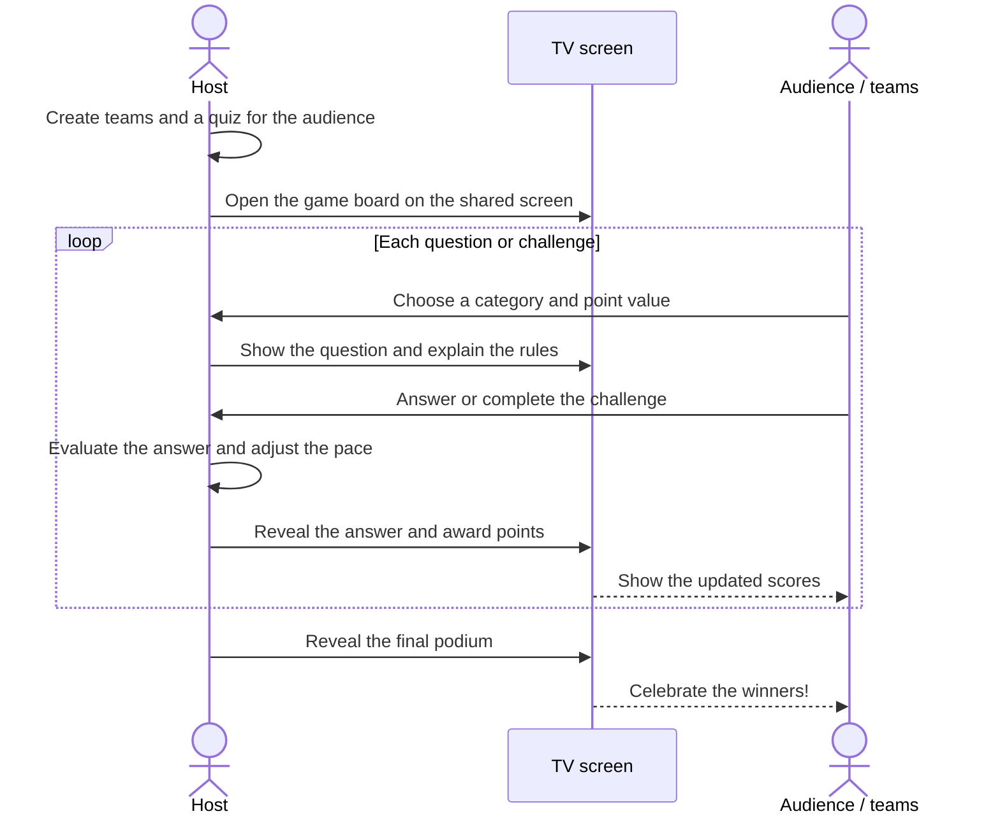
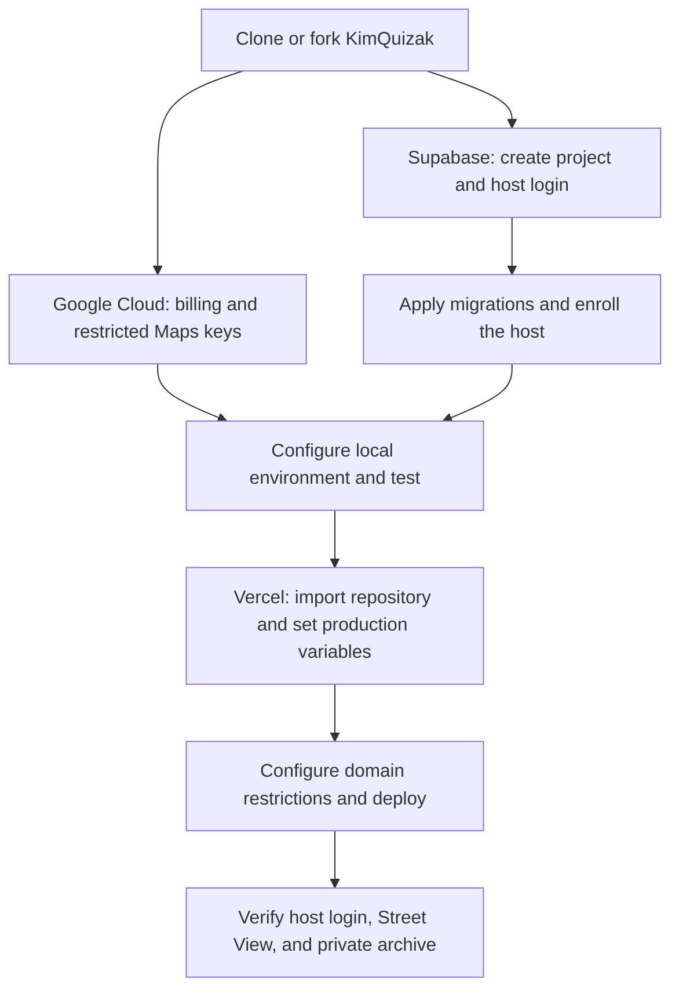
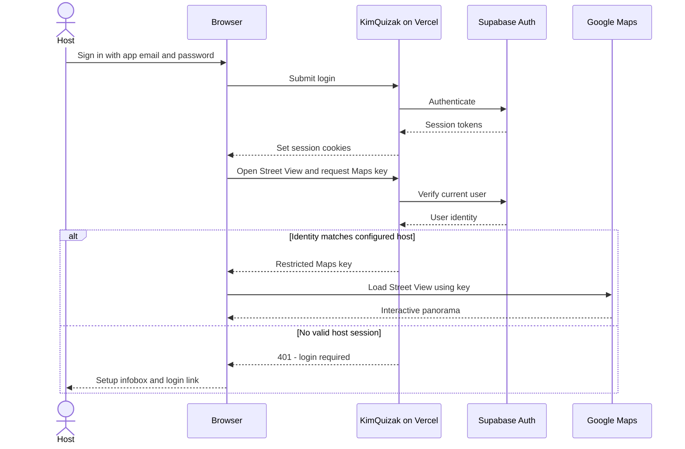
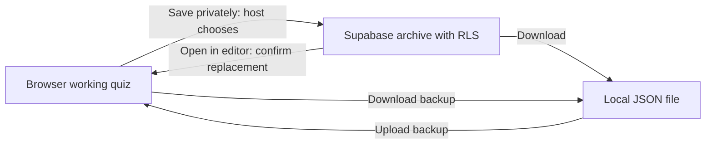

# KimQuizak

A host-led quiz and games board for teams playing together in a room. Create the quiz, show it on a shared screen, and let the host run questions, challenges, scoring, and the final podium. Try it at [kimquizak.com](https://kimquizak.com/).

Quiz data is saved in the browser by default. File import/export works without an account; host login enables optional cloud snapshots and interactive Geoguesser when those services are configured.

## How to play

The host runs KimQuizak on a shared TV or projector. Teams answer in the room; the host controls the pace, judges answers, and awards points.



## Quick start

Use Node.js **22.23.4 or newer within 22.x**, as specified in [`package.json`](package.json). [`.nvmrc`](.nvmrc) pins the development version. The minimum includes [Node.js security fixes released in October 2026](https://nodejs.org/en/blog/vulnerability/october-2026-security-releases).

If you use nvm, run `nvm use` first. Otherwise, install a compatible Node.js version before continuing.

```bash
npm install
npm run dev
```

The app uses Next.js 16 (App Router and TypeScript). `npm run dev` uses Turbopack; if development fails with a Turbopack error, stop the server and try `npm run dev:webpack`. The production build uses Webpack, as configured in [`package.json`](package.json).

Open http://localhost:3000. A fresh browser starts without questions. Create your own in **Questions**, or use **Questions → Local archive → Add example data**. Loading examples replaces the current browser quiz, so download a backup first if you want to keep it. Supabase and Google Maps configuration are optional for local quiz editing and play.

## Main flows

- **Home → Team palette**: choose themes for parties, birthdays, Halloween, Christmas, Easter, and more. Enable **Brand the site** to apply the selected theme’s colors and decorations across the site; leave it off to use the default site appearance. Theme choices are included in backups.
- **Teams**: set team names, colors/emojis, and players; shuffle players and reset the turn order. The optional host profile adds the host to the podium without making them a team.
- **Questions**: create categories and questions, choose question types, and reorder the board. Categories can have different numbers of questions. Configure whether category names start concealed.
- **Play**: draw the team order, open questions, reveal answers, and award points. Use score history to review recent changes or undo them.
- **Host**: sign in to explicitly save or restore a private cloud snapshot, if you have configured your own host account and archive.

## Question types

| Type | How it plays |
| --- | --- |
| **Standard** | A question and answer, with optional images. The host judges the answer. |
| **MCQ** | 2–12 choices, with one or more correct answers. The host sets how many correct picks finish the question. Points are split across that target; with rollover enabled, a wrong pick passes play to the next team. |
| **Text grid** | One word or segment per line becomes one tile. Teams uncover the text to identify the answer. Red tiles pass the turn without reducing the question's value; the host can also pass after a wrong guess. An optional YouTube answer video accepts supported watch, share, or embed links. |
| **Image reveal** | Reveal an image by zooming out, clearing blur, or selecting areas. The host configures reveal stages or areas and whether extra reveals cost points. |
| **Geoguesser** | Start from a saved Street View location. Choose a fixed view with paid timed exploration, look-and-zoom without movement, free exploration, or a two-phase stage challenge: timed exploration followed by a timed map guess scored by distance. Requires host login and Google Maps setup. |
| **Timeline** | Place events in chronological order around a configured starting event. The host decides whether misses pass to the next team. |
| **Audio** | Identify a YouTube audio clip. Set the start time and clip length; an optional replay lowers the available points to the next lower board tier. |
| **Trivia** | A sequence of questions, followed by host review of the teams' answers. Each team can earn up to the full tile value, based on its number of correct answers. |
| **Challenge** | A host-authored task with an optional image and countdown or count-up timer. The host marks it completed for full points or not completed for zero. The timer does not award points automatically. |
| **Joker high/low** | Guess higher or lower on configurable number columns. Correct and wrong guesses move the reward up or down a six-level ladder; finding the hidden Joker jumps to the top level. |
| **Connections** | Find groups of four among 16 tiles. The host chooses a target of 1–4 solved groups, with points split across it. Wrong guesses can pass play to the next team. Defaults are 120 seconds per guess and four shared mistakes; both limits are configurable. [Rules and setup](docs/connections.md). |

## Self-hosting guide

You can run the local quiz without cloud accounts. For an online copy with host login, Street View, and private cloud snapshots, this guide uses:

- **Google Cloud** for the Maps JavaScript API used by Street View and map guesses.
- **Supabase Auth** for the configured host account, and its Postgres database for optional private snapshots.
- **Vercel** to build and serve your copy of the Next.js app.

Use your own projects and configuration values. The blank [`.env.example`](.env.example) lists the required variable names. The bundled players and relationships are fictional.

**Interactive Geoguesser requires a configured Google Maps key and a signed-in host. There is no offline or image fallback.** Players watching the shared screen do not need accounts. YouTube questions still need access to YouTube; browser-local quiz storage does not make external media available offline.



### 1. Clone and run locally

Use Node.js 22.23.4 or newer within the 22.x release line. Fork the repository into your own GitHub account if you want Vercel to deploy your changes, then clone that fork. For a local evaluation:

```bash
git clone https://github.com/kimisak/kimquizak.git
cd kimquizak
npm install
npm run dev
```

Open `http://localhost:3000` to try the local app. For the optional services below, copy `.env.example` to `.env` only if you do not already have that file, then fill in your own values. Keep existing environment files intact.

### 2. Create Google Cloud credentials

1. Create a Google Cloud project for your copy and attach a billing account.
2. Enable **Maps JavaScript API**. The current implementation does not need Maps Embed API, Street View Static API, or Geocoding API.
3. Create separate development and production API keys. They can share one Google Cloud project.
4. For both keys, choose **Websites** under application restrictions and restrict API access to **Maps JavaScript API**.
5. Allow `http://localhost:3000/*` on the development key (add another exact local origin only if you use it).
6. On the production key, allow your own domain, such as `https://quiz.example.com/*`, and your exact Vercel production hostname if you use it. Add `www` separately if needed. Do not allow every `*.vercel.app` deployment.
7. Review Maps usage quotas and configure billing alerts. Budget alerts notify you; they are not a spending cap. Set supported API quotas to limits suitable for your usage and monitor actual consumption.

The key identifies the Google project billed for Maps usage. It is sent to the signed-in browser to load interactive Street View. Storing it in Vercel keeps it out of Git, but does not make it invisible in browser developer tools. Host login and Google's website/API restrictions serve different purposes; use both. Signing in alone does not load Street View.

See [Google's API setup](https://developers.google.com/maps/documentation/javascript/get-api-key), [security guidance](https://developers.google.com/maps/api-security-best-practices), [usage and billing](https://developers.google.com/maps/documentation/javascript/usage-and-billing), and [budget alerts](https://cloud.google.com/billing/docs/how-to/budgets).

### 3. Create Supabase and your host account

1. Create a Supabase project. Your Supabase dashboard login is separate from the app user you create next.
2. In **Authentication → Users → Add user → Create new user**, create your host email/password account. Confirm the email (or use Auto Confirm User for this account).
3. Disable **Allow new users to sign up** under Authentication settings. Keep anonymous sign-ins disabled. There is no public registration page in this app.
4. Copy the host user's UUID. This single account is allowed to access Street View and the private archive.
5. From the project's **Connect** dialog, copy the project URL and publishable key. The publishable key is intended for browser use; do not substitute a secret/service-role key.
6. In Authentication URL Configuration, set Site URL to your own production URL. The current email/password login does not use an OAuth callback; email recovery or social login would need their own redirect setup if added later.

See [Supabase Auth configuration](https://supabase.com/docs/guides/auth/general-configuration) and [API keys](https://supabase.com/docs/guides/getting-started/api-keys).

### 4. Apply migrations and enroll your host

From the repository root, authenticate the CLI and link **your** project's reference (the identifier in its Supabase dashboard URL):

```bash
npx supabase login
npx supabase link --project-ref YOUR_PROJECT_REF
npx supabase migration list --linked
npx supabase db push --linked --dry-run
npx supabase db push --linked
```

This creates the private archive and its row-level security rules, including deletion. Next, enroll your app host. Replace `YOUR_HOST_UUID` with the UUID from Authentication → Users:

```bash
npx supabase db query --linked "insert into private.quiz_owners (user_id) values ('YOUR_HOST_UUID') on conflict do nothing;"
```

Use that same UUID in `KIMQUIZAK_OWNER_USER_ID`. **The UI says Host; existing environment variables, function names, and database identifiers retain `owner` for compatibility.** No schema rename is required.

CLI login is for project administration and migrations; app login is for the host session. Do not put CLI credentials in Vercel. For future schema changes, add migration files and run `db push`. If you applied SQL manually, reconcile migration history first. Re-running the initial migration resets table grants, and a remote `db reset` can remove data. See [Supabase migrations](https://supabase.com/docs/guides/deployment/database-migrations).

### 5. Configure environment variables

Put local values in the ignored `.env` file. Add production values in **Vercel → Project → Settings → Environment Variables → Production**.

| Variable | Local development | Vercel production |
| --- | --- | --- |
| `NEXT_PUBLIC_SUPABASE_URL` | Your Supabase project URL | Your Supabase project URL |
| `NEXT_PUBLIC_SUPABASE_PUBLISHABLE_KEY` | Your publishable key | Your publishable key |
| `KIMQUIZAK_OWNER_USER_ID` | Your host's UUID | Same host UUID enrolled in the database |
| `GOOGLE_MAPS_API_DEV_KEY` | Restricted localhost key | Leave unset |
| `GOOGLE_MAPS_API_PROD_KEY` | Usually leave unset | Restricted production key |
| `GOOGLE_MAPS_API_KEY` | Optional override; usually unset | Optional override; usually unset |

A non-empty `GOOGLE_MAPS_API_KEY` takes precedence over both environment-specific keys. Otherwise development uses `DEV_KEY`, and production uses `PROD_KEY` without falling back to the development key. A local production build also uses `PROD_KEY`.

Restart local development after changing `.env`. Redeploy after changing Vercel variables; `NEXT_PUBLIC_` values are embedded at build time. Keep `.env`, CLI credentials, and personal exports out of Git. The ignored `private/` directory is convenient local storage, not encryption or login-protected storage.

### 6. Deploy to Vercel

1. Import your own repository into Vercel and select the Next.js framework preset.
2. Use Node.js **22.x**, the repository root, and the existing `npm run build` build command. Vercel manages minor and patch updates within the selected major version; see its [runtime version policy](https://vercel.com/docs/functions/runtimes/node-js/node-js-versions).
3. Add the production variables above before deploying. Do not include a database password, Supabase administration token, or service-role key in the app's public variables.
4. Deploy, then add your custom domain if desired. Follow the DNS records Vercel provides for your domain registrar.
5. Ensure the final domain is allowed on the production Maps key and configured as your Supabase Site URL.
6. Treat Preview separately: previews are production builds too. Leave Maps unconfigured there, or use a separate restricted key and appropriate Supabase configuration. A production-only variable is not automatically available in Preview.

Vercel deploys committed source from the selected Git revision. Unpushed local changes are not included when redeploying an existing Git deployment. Database migrations run separately through the CLI; Vercel builds do not apply them automatically.

See [Vercel environment variables](https://vercel.com/docs/environment-variables) and [Node.js versions](https://vercel.com/docs/functions/runtimes/node-js/node-js-versions).

### 7. Verify your deployment

- In a fresh browser profile, confirm local editing and fictional demo loading work. Geoguesser should show its setup/sign-in infobox; `/api/maps/config` and `/api/quizzes` should return `401` without a host session.
- Click **Host**, sign in using the app user from Supabase, and open a Street View question. Check Google Cloud usage after testing.
- Save a synthetic quiz, open it in the editor, download it, and delete the test copy from the archive. Opening replaces local teams, questions, settings, scores, and progress after confirmation. Deleting removes only the selected cloud copy.
- Sign out and check private access in a fresh tab. Signing out does not erase browser-local quizzes or revoke a Maps key already delivered to a browser; clear local data on shared devices.



Cloud snapshots are separate from the working quiz:



For troubleshooting and the migration workflow, see [host setup notes](docs/owner-setup.md). An infobox after login can indicate a missing key, incorrect domain/API restrictions, disabled billing, a network failure, or unavailable panorama imagery; check the displayed error and browser console.

## Persistence

Quiz edits stay in this browser unless you export a file or deliberately save a cloud snapshot.

| Data | Default storage |
| --- | --- |
| Questions and their uploaded images | IndexedDB, in the browser |
| Teams, host profile, scores, settings, turn order, and supported round progress | localStorage, in the browser |
| Downloaded backups | JSON files saved to your device, including images |
| Explicitly saved private snapshots | Supabase, accessible through the configured host account |

The local storage implementation is in [`questionStorage.ts`](src/lib/questionStorage.ts) and [`usePersistentState.ts`](src/hooks/usePersistentState.ts). Existing questions stored in localStorage are migrated to IndexedDB when read.

Cloud snapshots are separate copies, not automatic synchronization. **Host → Save this browser’s quiz privately** uploads a snapshot. Opening one asks before replacing the browser's quiz. Deleting one removes the cloud copy, not the local working quiz. The API accepts snapshots up to 3 MB and lists the latest 100; larger quizzes can use file backups.

Signing out does not erase browser-local quiz data. On a shared device, use **Clear everything** in the local archive when finished. Clearing browser storage also removes local quizzes, so export a backup if you need to keep them.

**Add example data** replaces the current browser quiz with [`default_questions.json`](default_questions.json). Its players and relationships are fictional. It includes examples of ten question types; Connections is supported by the app but is not included in this fixture. The zoom-reveal image is a CC0 photograph; its [source and license](docs/demo-image-source.md) are recorded separately.

Keep personal exports out of Git. The ignored `private/` directory and `kimquizak-backup-*.json` filenames help prevent accidental commits; they do not encrypt or password-protect files.

## Scripts

- `npm run dev` – start the Turbopack dev server
- `npm run dev:webpack` – start the Webpack dev server as a fallback
- `npm run build` – production build
- `npm start` – serve the production build locally
- `npm test` – regression checks for quiz rules, persistence, audio, and host access
- `npm run test:browser` – Playwright browser regression suite (see [`docs/regression-review.md`](docs/regression-review.md) for setup)
- `npm run lint` – lint with Next/ESLint defaults
- `npm run audit:privacy -- --history` – scan public files and local Git history for selected credential patterns, private file paths, and raster pictures (including those embedded in quiz JSON); see [privacy review](docs/privacy-review.md) for findings and limits.

## Notes

- Animal artwork credits and modifications are recorded in [`public/team-animals/NOTICE.txt`](public/team-animals/NOTICE.txt).
- Built by Kim Isak with Codex.
- Automated browser checks use Playwright/Chromium; manual testing has included Microsoft Edge. Browser autoplay settings can require a click before media plays.
